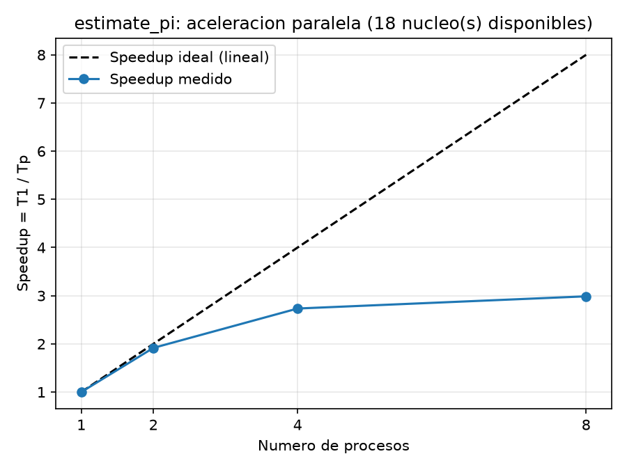
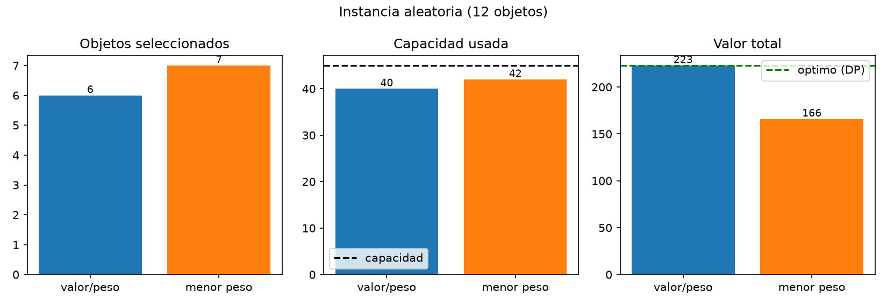
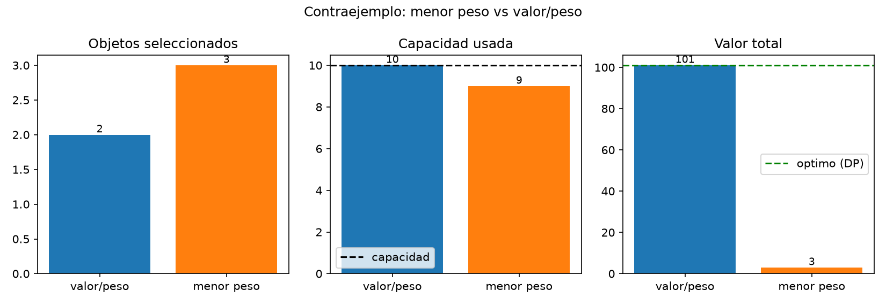
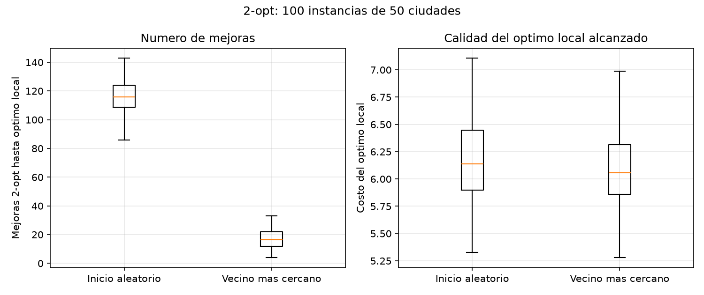
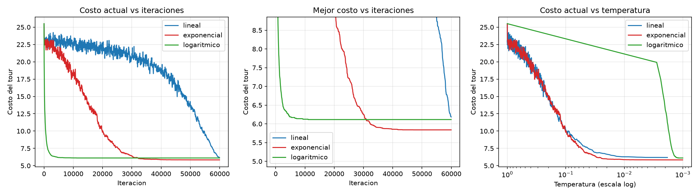
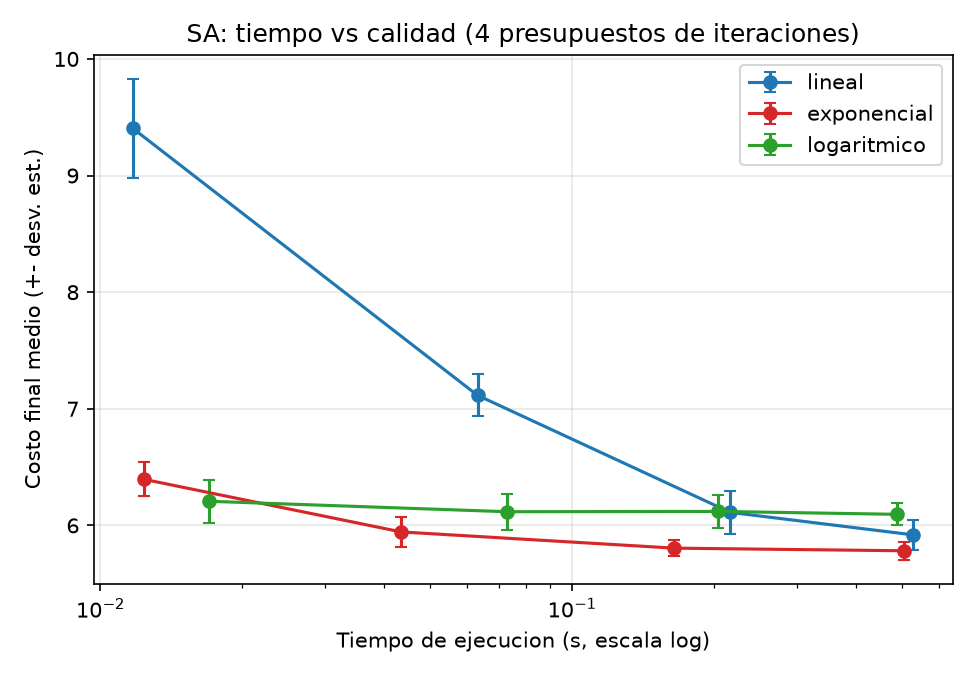
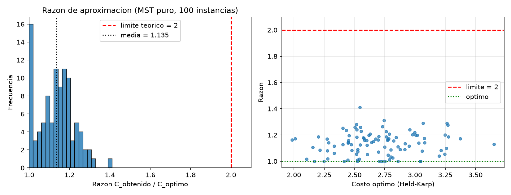
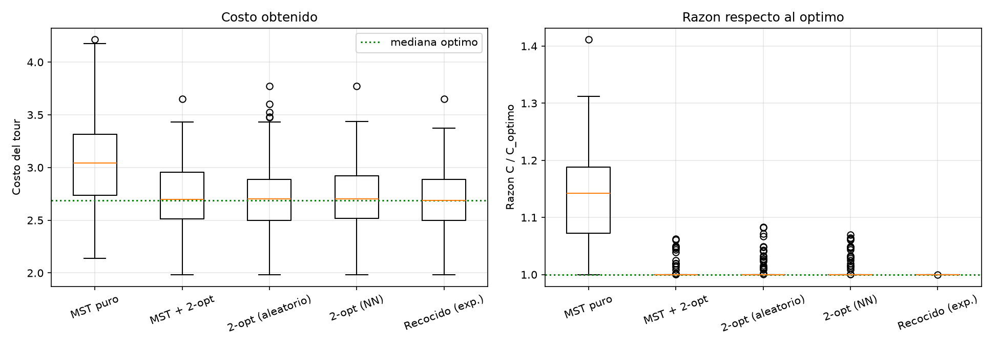

# Optimización y Heurísticas: Reporte Final

- **Repositorio:** `<PEGAR_URL_PUBLICA_DEL_REPOSITORIO>`
- **Video demo (máx. 8 min):** `<PEGAR_ENLACE_AL_VIDEO>`

## Estructura y ejecución

```
.
├── README.md            <- este reporte
├── requirements.txt     <- numpy, matplotlib, scipy
├── run_all.py           <- corre todos los experimentos
├── src/
│   ├── common.py        <- TSP: distancias, vecino más cercano, 2-opt, MST, Held-Karp
│   ├── ejercicio1_pi.py
│   ├── ejercicio2_knapsack.py
│   ├── ejercicio3_2opt.py
│   ├── ejercicio4_sa.py
│   └── ejercicio5_mst.py
├── figures/             <- gráficas (PNG)
└── results/             <- tablas (CSV)
```

```bash
pip install -r requirements.txt
python run_all.py                 # o: python src/ejercicio3_2opt.py (desde la raíz del repo)
```
Todas las semillas están fijas, por lo que los resultados son reproducibles (excepto los tiempos de ejecución).

---

## Ejercicio 1: Aceleración paralela (`estimate_pi`)

Monte Carlo con 40 000 000 muestras totales (tamaño fijo, *escalamiento fuerte*), repartidas entre `p` procesos con `multiprocessing.Pool`. Tiempo = mediana de 5 repeticiones.

| Procesos | Tiempo (s) | Speedup | Eficiencia |
|---|---|---|---|
| 1 | 1.064 | 1.00 | 1.00 |
| 2 | 1.076 | 0.99 | 0.49 |
| 4 | 1.109 | 0.96 | 0.24 |
| 8 | 1.901 | 0.56 | 0.07 |



> ⚠️ **Advertencia importante:** estos números se midieron en un entorno con **1 solo núcleo de CPU**, por lo que no pueden mostrar aceleración real (los procesos compiten por el mismo núcleo). **Vuelve a ejecutar `python src/ejercicio1_pi.py` en tu máquina** (con ≥ 4-8 núcleos) y usa *esa* gráfica y tabla en tu entrega y video. El código y el análisis no cambian.

**Análisis: ¿por qué no es lineal?**
1. **Ley de Amdahl:** si una fracción `s` del trabajo es secuencial, `S(p) = 1 / (s + (1 − s)/p)` y `S(∞) = 1/s`. Aquí el reparto de tareas y la suma final son secuenciales; con `s = 5 %`, `S(8) ≈ 5.9` y nunca pasa de 20.
2. **Sobrecostos de procesos:** crear el `Pool` (fork/spawn), serializar argumentos/resultados (pickle) y destruirlo es un costo fijo que no disminuye con `p`; pesa más cuanto más corta es la tarea.
3. **Comunicación y sincronización:** `pool.map` es una barrera; el tiempo total es el del proceso más lento (desbalance, *stragglers*).
4. **Recursos compartidos:** ancho de banda de memoria, caché y *turbo boost* (más núcleos activos → menor frecuencia), y más procesos que núcleos físicos genera cambios de contexto. El caso de 8 procesos en 1 núcleo (S = 0.56) es el extremo de este efecto.

---

## Ejercicio 2: Mochila voraz, menor peso vs. valor/peso

Se modificó `voraz(items, capacidad, clave)`: criterio original `−valor/peso`; criterio nuevo `peso` ascendente. Óptimo calculado con programación dinámica como referencia.

**Instancia aleatoria (12 objetos, capacidad 45, óptimo = 223):**

| Método | Objetos seleccionados | Nº | Capacidad usada | Valor total |
|---|---|---|---|---|
| valor/peso | o12, o6, o8, o2, o5, o3 | 6 | 40 | **223** (óptimo) |
| menor peso | o3, o6, o12, o8, o7, o10, o1 | 7 | 42 | 166 |



**Instancia diseñada donde menor peso es peor** (capacidad 10), objetos `(peso, valor)`: A(2,1), B(3,1), C(4,1), D(8,100):

| Método | Objetos | Capacidad usada | Valor total |
|---|---|---|---|
| valor/peso | D, A | 10 | **101** (óptimo) |
| menor peso | A, B, C | 9 | 3 |



Menor peso toma A, B y C (los más ligeros), y ya no cabe D, que aporta casi todo el valor. El criterio ignora el valor por completo, así que su razón de aproximación no está acotada (aquí 3/101).
Complemento empírico (2000 instancias aleatorias de 10 objetos): menor-peso fue **peor en 1483 (74 %)**, igual en 501 (25 %) y mejor en 16 (0.8 %) que valor/peso.

---

## Ejercicio 3: 2-opt para TSP, inicio aleatorio vs. Vecino Más Cercano

100 instancias aleatorias de 50 ciudades (cuadrado unitario). En cada una: 2-opt (primera mejora) desde (a) permutación aleatoria y (b) Vecino Más Cercano con nodo inicial aleatorio. "Mejora" = un intercambio 2-opt aplicado.

| Inicio | Mejoras (media / mediana) | Costo inicial medio | Costo del óptimo local (media ± std) |
|---|---|---|---|
| Aleatorio | 116.6 / 116 | 26.17 | 6.152 ± 0.363 |
| Vecino más cercano | **16.9 / 16.5** | 6.95 | **6.066 ± 0.348** |



**Análisis:** Sí. Partir de Vecino Más Cercano necesita en promedio ≈ 7 veces menos mejoras (17 vs 117; prueba de Wilcoxon pareada p ≈ 4·10⁻¹⁸), y los diagramas de caja ni siquiera se traslapan. NN ya entrega un tour con costo ≈ 6.95 (el aleatorio, 26.2), por lo que 2-opt solo "pule" defectos locales. Además la calidad final es ligeramente mejor (6.07 vs 6.15, p ≈ 0.006); la diferencia es pequeña frente a la dispersión entre instancias (std ≈ 0.35), así que la ventaja principal de NN es la **velocidad de convergencia**, no la calidad.

---

## Ejercicio 4: Recocido Simulado con 2-opt

SA con movimiento 2-opt (invertir un segmento aleatorio), solución inicial aleatoria, instancia de 50 ciudades, T₀ = 1, T_f = 10⁻³, probabilidad de aceptación `exp(−Δ/T)`. Los tres esquemas parten de T₀ y llegan a T_f en el mismo número de iteraciones N:
- **Lineal:** `T = T₀ − (T₀−T_f)·k/N`
- **Exponencial (geométrico):** `T = T₀·(T_f/T₀)^(k/N)`
- **Logarítmico:** `T = T₀ / (1 + a·ln(1+k))`, con `a` tal que `T(N)=T_f`



Tiempo vs. calidad (10 corridas por punto, N ∈ {5k, 20k, 80k, 200k}):

| Esquema | N=5 000 | N=20 000 | N=80 000 | N=200 000 |
|---|---|---|---|---|
| Lineal | 9.40 (0.01 s) | 7.12 (0.06 s) | 6.11 (0.22 s) | 5.92 (0.54 s) |
| Exponencial | **6.40** (0.01 s) | **5.94** (0.05 s) | **5.81** (0.22 s) | **5.78** (0.54 s) |
| Logarítmico | 6.21 (0.01 s) | 6.12 (0.05 s) | 6.12 (0.21 s) | 6.10 (0.53 s) |

(costo final medio; tiempo medio entre paréntesis)



**Análisis:**
- **Tiempo de cómputo:** prácticamente idéntico entre esquemas con igual N (~2.7 µs/iteración): calcular T es despreciable frente al movimiento. El tiempo depende del **presupuesto N**, no del esquema; lo que cambia es la **calidad que se obtiene por unidad de tiempo**. En el plano tiempo-calidad la curva exponencial domina a las demás en todo el rango.
- **Exponencial:** reparte el tiempo de forma equilibrada (exploración a T alta y refinamiento a T baja): mejor calidad y menor varianza con N grande (5.78 ± 0.08 con N = 200k).
- **Lineal:** permanece mucho tiempo en temperaturas altas donde la búsqueda es casi un paseo aleatorio (costo ≈ 22 durante la mayor parte de la corrida) y solo enfría efectivamente al final; con presupuestos chicos es mucho peor (9.40 vs 6.40 con N=5k), aunque mejora con N grande.
- **Logarítmico (con esta calibración):** como debe llegar a T_f en N pasos, la temperatura se desploma en las primeras ~100 iteraciones, así que el algoritmo se comporta como un descenso (*quenching*) que se atora en un óptimo local ≈ 6.1 y no mejora al aumentar N. Es el más rápido en converger pero el peor al final. *Limitación:* el logarítmico clásico (T = c/ln(1+k)) requiere constantes `c` específicas y cadenas mucho más largas; no se afinó `c`, por lo que esta conclusión aplica a esta parametrización.

---

## Ejercicio 5: Razón de aproximación del algoritmo MST

2-aproximación: MST (Prim) → recorrido en preorden → atajos. 100 instancias euclidianas aleatorias de 9 ciudades; óptimo exacto por Held-Karp. Se comparan también 2-opt (inicio aleatorio y NN), SA exponencial (N = 5 000) y MST + 2-opt.

| Método | Razón media | Mediana | Máxima | % instancias óptimas |
|---|---|---|---|---|
| MST puro | 1.135 | 1.142 | **1.411** | 10 % |
| MST + 2-opt | 1.006 | 1.000 | 1.063 | 80 % |
| 2-opt (aleatorio) | 1.008 | 1.000 | 1.083 | 77 % |
| 2-opt (NN) | 1.007 | 1.000 | 1.070 | 79 % |
| Recocido (exp.) | 1.000 | 1.000 | 1.000 | 100 % |




**Análisis:**
- **¿Qué tan cerca del límite de 2?** Muy lejos: la razón media es 1.135 y la peor observada 1.411, es decir, ≈ 29 % por debajo de la cota teórica en el peor caso. La cota 2 es de *peor caso*, alcanzable solo con instancias patológicas; en puntos uniformes aleatorios el recorrido en preorden del MST rara vez duplica el costo (el MST cuesta ≈ 0.70 del óptimo en promedio y los atajos recuperan buena parte del factor 2).
- **Efecto de 2-opt como post-procesamiento:** reduce la razón media de 1.135 a 1.006 y sube de 10 % a 80 % las instancias óptimas, y la peor razón de 1.41 a 1.06. Frente a los experimentos previos, MST + 2-opt queda al nivel de 2-opt desde inicio aleatorio o NN (1.006 vs 1.008/1.007): la diferencia es mínima y con 100 instancias no es concluyente (no se hizo prueba estadística). La ventaja de MST como inicio es que *además* garantiza un punto de partida ≤ 2·óptimo. El Recocido alcanzó el óptimo en las 100 instancias, aunque con n = 9 el espacio (8!/2 = 20 160 tours) es diminuto y 5 000 iteraciones lo exploran casi por completo; este resultado **no** se extrapola a instancias grandes (ver Ej. 4, donde el SA con N finito deja variabilidad).

---

## Notas y limitaciones
- Ej. 1 medido en 1 núcleo (ver advertencia); repetir en hardware multinúcleo.
- Instancias aleatorias euclidianas en [0,1]²; los resultados pueden variar con otras distribuciones.
- Los resultados de SA dependen de T₀, T_f y la calibración de cada esquema.
# optimizacion-heuristicas
